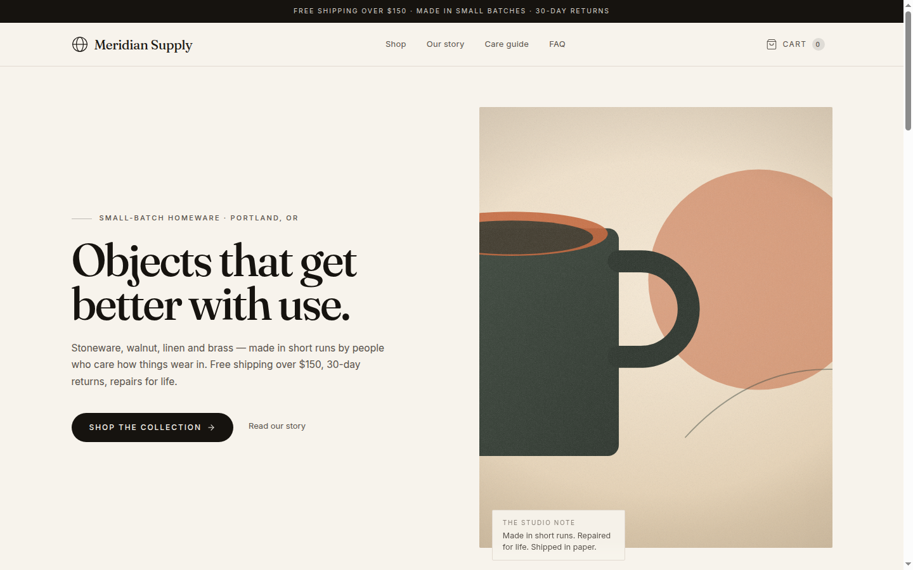
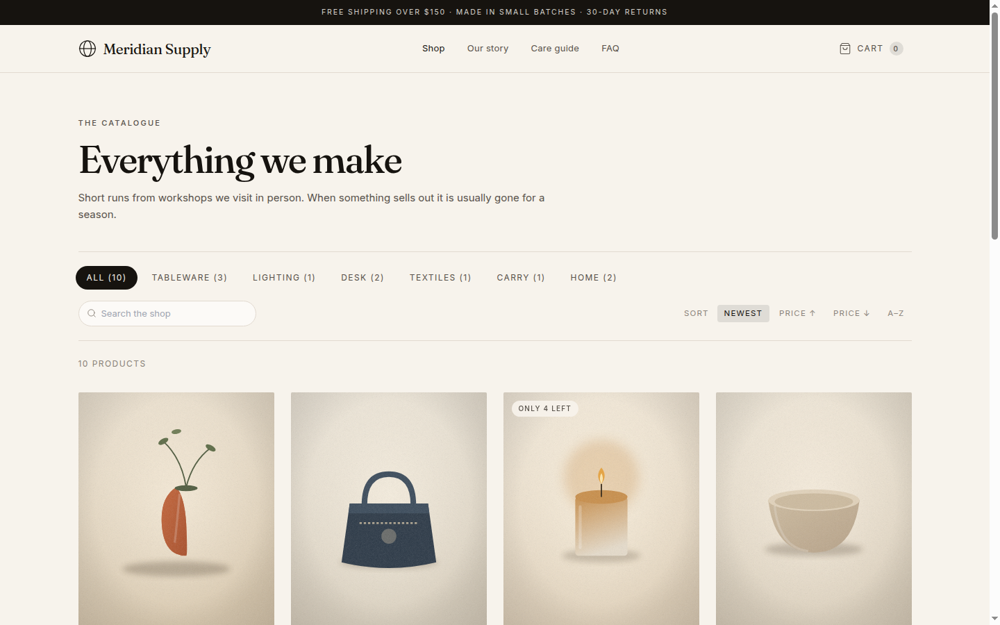
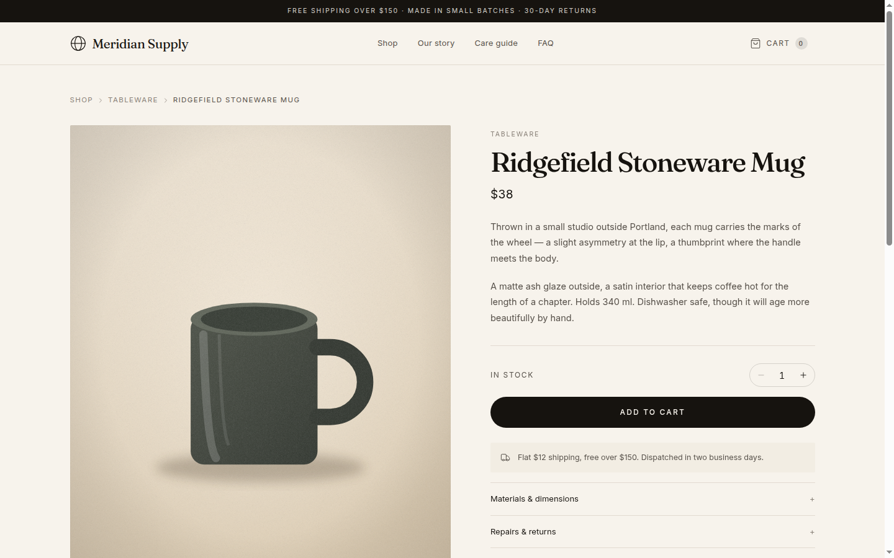
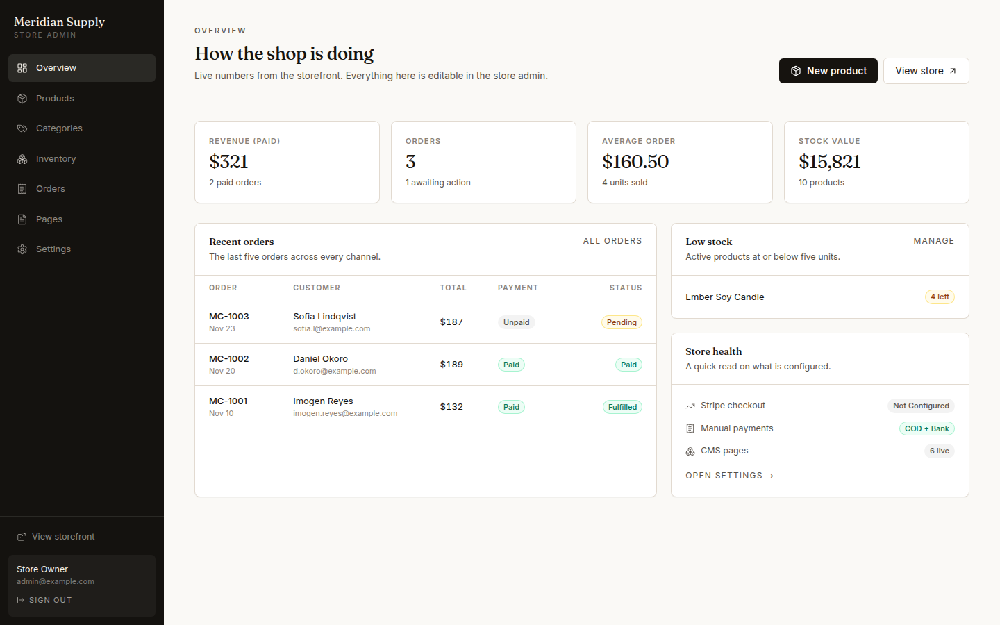
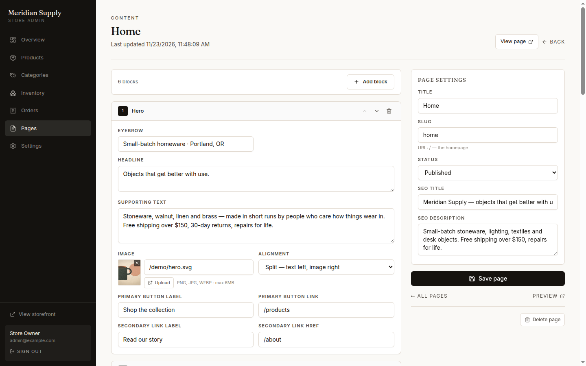
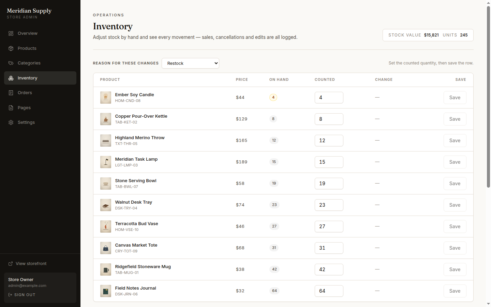

# Meridian Commerce

An open-source, self-hosted e-commerce platform: a dynamic storefront, a full CMS, an
inventory ledger and pluggable payments — in one Next.js app with a SQLite database.
No SaaS account, no per-order fees, no vendor lock-in.

> This repository ships with a fully seeded demo store ("Meridian Supply") so you can
> click through products, checkout and the admin panel within a minute of cloning.



<details>
<summary><strong>More screenshots</strong> — catalogue, product page, admin, mobile</summary>

| | |
| --- | --- |
| **Catalogue** — search, filters, stock badges | **Product page** — pricing, stock, adds to cart |
|  |  |
| **Admin dashboard** — revenue, orders, low stock | **Page editor** — block-based CMS |
|  |  |
| **Inventory** — counted stock + movement ledger | **Mobile storefront** |
|  |  |

</details>

## What you get

**Storefront**
- CMS-driven home page and content pages (built from reusable blocks, not hardcoded templates)
- Catalogue with search, category filters, sorting and stock-aware product cards
- Product pages with galleries, compare-at pricing, sale badges and stock messaging
- Client-side cart (localStorage) with a slide-over drawer and a full cart page
- Checkout with shipping rules, optional tax, order notes and server-side price validation
- Order confirmation with payment instructions per provider
- Sitemap, robots.txt, SEO metadata driven by the CMS

**Admin panel** (`/admin`)
- Dashboard: revenue, orders, average order value, stock value, low-stock alerts
- Products: CRUD, image uploads, pricing, categories, featured flag, drafts
- Categories: inline editing and ordering
- Inventory: set counted stock with a reason; every movement is written to a ledger
- Orders: filter, search, inspect, change status, mark paid, fulfil, cancel (stock returns automatically)
- Pages: block editor for every storefront page — hero, product grid, image + text, FAQ,
  features, gallery, quote, rich text, CTA
- Settings: branding and accent colour, currency, contact details, navigation, shipping,
  tax, payment providers and admin password

**Payments (pluggable)**
- Cash on delivery (built in)
- Bank transfer with instructions rendered at checkout and on the confirmation page
- Stripe Checkout (REST, no SDK) with webhook signature verification
- Add your own provider in ~40 lines — see [`docs/PAYMENTS.md`](docs/PAYMENTS.md)

## Tech stack

| Layer | Choice | Why |
| --- | --- | --- |
| Framework | Next.js 15 (App Router, React 18, TypeScript) | Server components for the storefront, one deployable for UI + API |
| Styling | Tailwind CSS 3 | Design tokens live in `tailwind.config.ts` and CSS variables |
| Database | SQLite via `node:sqlite` | Zero native dependencies, zero services to run, file-based backup |
| Auth | scrypt password hashing + HttpOnly session cookies | No third-party identity provider required |
| Money | Integer cents everywhere | No floating-point rounding in totals |
| Fonts/assets | Self-hosted fonts, local demo artwork | No external CDN calls at runtime |

## Quick start

```bash
git clone https://github.com/daxjain789/e-commerce.git
cd e-commerce
cp .env.example .env.local     # edit the admin credentials!
npm install
npm run dev                    # http://localhost:3000
```

The database file is created on first request at `data/store.db` and seeded with the demo
catalogue, CMS pages and three sample orders. Sign in at `/admin` with the
`ADMIN_EMAIL` / `ADMIN_PASSWORD` from your environment file
(defaults: `admin@example.com` / `change-me-now` — **change these before deploying**).

### Useful scripts

```bash
npm run dev        # development server
npm run build      # production build
npm run start      # production server (after build)
npm run typecheck  # TypeScript, no emit
npm run lint       # ESLint
npm run db:reset   # delete the SQLite database; it is reseeded on next boot
```

## Configuration

Everything in `.env.example` is optional except the admin credentials you choose.

| Variable | Default | Purpose |
| --- | --- | --- |
| `DATABASE_PATH` | `./data/store.db` | SQLite file location (directory is created) |
| `NEXT_PUBLIC_SITE_URL` | `http://localhost:3000` | Absolute URL used for Stripe redirects, sitemap and metadata |
| `ADMIN_EMAIL` | `admin@example.com` | Admin account created on first boot only |
| `ADMIN_PASSWORD` | `change-me-now` | Password for that account (hashed with scrypt) |
| `ADMIN_NAME` | `Store Owner` | Display name in the admin sidebar |
| `SEED_DEMO_DATA` | `true` | Set `false` to start with an empty catalogue |

Store settings (brand name, accent colour, currency, shipping, tax, navigation, payment
keys) live in the database and are edited at `/admin/settings`. The storefront reads them
on every request, so changes are live immediately — no redeploy.

## Stripe setup

1. In `/admin/settings → Payments`, enable Stripe and paste your secret key (`sk_test_…`).
2. Add a webhook endpoint in the Stripe dashboard:
   `https://your-domain/api/payments/stripe/webhook`
   with the events `checkout.session.completed`, `checkout.session.expired` and
   `payment_intent.payment_failed`.
3. Paste the signing secret (`whsec_…`) into the same panel. Orders are marked paid by the
   webhook; the success page also verifies the session as a belt-and-braces fallback.

Nothing card-related is stored or processed by this app — it redirects to Stripe Checkout.

## Deploy

### Docker (recommended)

```bash
cp .env.example .env
docker compose up -d --build
```

`docker-compose.yml` mounts two volumes: `store-data` for the SQLite database and
`store-uploads` for admin image uploads.

### Any Node host

```bash
npm ci
npm run build
DATABASE_PATH=/var/lib/meridian/store.db NEXT_PUBLIC_SITE_URL=https://shop.example.com npm run start
```

Requirements: Node **22.5+** (for `node:sqlite`), a writable directory for the database and
`public/uploads`, and a reverse proxy with TLS in front. Run a single instance per database
file — SQLite is not a networked database. For higher traffic, swap the repository layer in
`src/lib/repo` for Postgres (see [`docs/ARCHITECTURE.md`](docs/ARCHITECTURE.md)).

### Backups

The entire store is the SQLite file plus `public/uploads`. Copy both:

```bash
sqlite3 data/store.db ".backup 'backup-$(date +%F).db'"
```

## Project structure

```
src/
├── app/
│   ├── (store)/            # storefront: home, catalogue, product, cart, checkout, CMS pages
│   ├── admin/              # admin panel (auth-guarded server components)
│   └── api/                # REST endpoints: auth, products, categories, pages, orders,
│                           # inventory, settings, uploads, checkout, Stripe webhook
├── components/
│   ├── store/              # cart provider/drawer, header/footer, blocks renderer, forms
│   └── admin/              # shell, product/page editors, tables, settings form
└── lib/
    ├── db.ts               # schema + node:sqlite connection
    ├── seed.ts             # demo catalogue, pages, orders
    ├── repo/               # typed data access: products, categories, pages, orders
    ├── blocks.ts           # CMS block definitions (shared by editor and renderer)
    ├── settings.ts         # typed settings with defaults + secret masking
    ├── payments.ts         # Stripe Checkout + webhook verification
    ├── auth.ts             # sessions, guards, scrypt hashing
    └── money.ts            # integer-cent formatting/parsing
```

## The CMS in one paragraph

Pages are rows in SQLite; each page is an ordered list of JSON blocks rendered by
`src/components/store/blocks.tsx`. `src/lib/blocks.ts` declares every block type, its
fields and its repeater items — the admin editor generates its forms from those
definitions, so adding a block type means adding one entry and one renderer case. Nothing
in the storefront is hardcoded: the home page, About, FAQ, care guide and shipping pages
are all editable in `/admin/pages`.

## API

The admin UI is built on a small REST API you can also use headlessly:

```
POST   /api/auth/login          { email, password }
POST   /api/auth/logout
POST   /api/auth/password       { currentPassword, newPassword }
GET    /api/products            ?q=&category=&sort=&limit=
POST   /api/products            (admin)
PATCH  /api/products/:id        (admin)
DELETE /api/products/:id        (admin)
GET    /api/categories
POST   /api/categories          (admin)
PATCH  /api/categories/:id      (admin)
DELETE /api/categories/:id      (admin)
GET    /api/pages               (admin)
POST   /api/pages               (admin)
PATCH  /api/pages/:id           (admin)
DELETE /api/pages/:id           (admin)
GET    /api/inventory           ?product=      (admin, stock ledger)
POST   /api/inventory           { productId, stock, reason }   (admin)
GET    /api/orders/:id          (admin)
PATCH  /api/orders/:id          { status, paymentStatus, notes } (admin)
GET    /api/settings            (admin)
PUT    /api/settings            (admin)
POST   /api/uploads             multipart file (admin)
POST   /api/checkout            { items, name, email, address, paymentProvider, notes }
POST   /api/payments/stripe/webhook
```

All prices in requests and responses are integer **cents** in the store currency.

## Contributing

Issues and pull requests are welcome. Please read [`CONTRIBUTING.md`](CONTRIBUTING.md) and
the [`CODE_OF_CONDUCT.md`](CODE_OF_CONDUCT.md) first. Security reports: see
[`SECURITY.md`](SECURITY.md).

## License

MIT — see [`LICENSE`](LICENSE).
